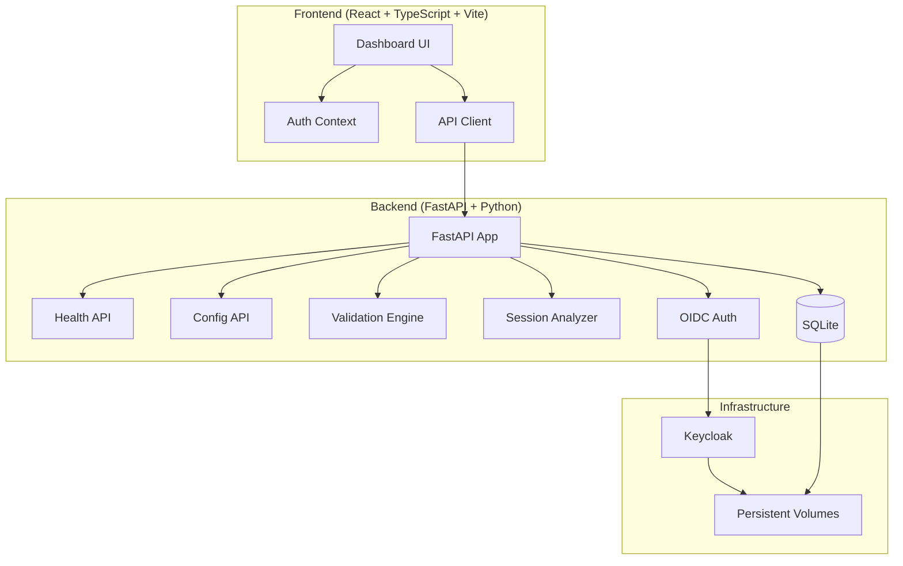

# Vector Studio

> Work in progress. This checkpoint may be incomplete or fail tests. See PLAN.md and STATUS.md before use.


**Vector Studio** | Ryan Vo | AI & Machine Learning

Vector Studio is an AI/ML developer tool for managing AI agent configurations, hooks, and workflows. It helps developers validate, analyze, and optimize their AI agent setups—like the ponytail plugin for Claude Code—by providing schema validation, session transcript analysis, and configuration management.

## The Problem

AI agent configurations (hooks, skills, commands) are complex and error-prone. Developers face:
- Schema validation failures when agent platforms update their plugin APIs
- Hook execution order conflicts causing skipped handlers
- Cross-platform line ending issues (CRLF vs LF) breaking tests on Windows
- No visibility into session transcript execution patterns

## AI/ML Approach

Vector Studio implements a **deterministic validation engine** that parses agent configurations and session transcripts, applying formal schema validation and static analysis to detect:
- Agent Plugins schema compliance violations
- Hook event ordering conflicts (e.g., built-in plugins skipping custom handlers)
- Line ending inconsistencies across platforms
- Missing transcript paths on first prompt of sessions

This works **offline without any LLM key**. LLM-powered explanations are opt-in, labeled advisory, and grounded in actual validation results.

## Features

- **Configuration Management**: Create, validate, import, export agent configurations
- **Hook Schema Validation**: Validate against Agent Plugins specification with actionable errors
- **Session Analysis**: Parse transcripts, detect skipped/failed hooks, generate quality reports
- **Cross-Platform Line Ending Detection**: Identify CRLF issues before they break CI
- **OIDC Authentication**: Secure login via Keycloak with SAML broker support
- **Role-Based Access**: Viewer, Operator, Admin roles with endpoint authorization

## Quick Start

### Prerequisites
- Docker and Docker Compose
- Node 24+ (for local frontend development)
- Python 3.12+ (for local backend development)

### Using Docker Compose (Recommended)

```bash
# Copy environment template
cp .env.example .env

# Start all services
docker compose up -d

# Access the application
# Frontend: http://localhost:5173
# Backend API: http://localhost:8000
# API Docs: http://localhost:8000/docs
# Keycloak: http://localhost:8080 (admin/admin)
```

### Local Development

**Backend:**
```bash
cd backend
python3 -m venv .venv
source .venv/bin/activate
pip install -r requirements.txt
cp ../.env.example .env
# Edit .env with your settings
python -m uvicorn app.main:app --reload --host 127.0.0.1 --port 8000
```

**Frontend:**
```bash
cd frontend
npm install
cp ../.env.example .env.local
# Edit .env.local with your settings
npm run dev
```

### Running Tests

**Backend:**
```bash
cd backend
source .venv/bin/activate
PYTHONPATH=. python -m pytest tests/ -v
```

**Frontend:**
```bash
cd frontend
npm run test
```

## Architecture



## API Endpoints

| Method | Path | Description |
|--------|------|-------------|
| GET | /health/ | Health check |
| GET | /health/db | Database health check |
| GET | / | Root endpoint |
| GET | /docs | OpenAPI documentation |

*More endpoints coming in future releases.*

## Security

- **Authentication**: OIDC authorization code flow with PKCE via Keycloak
- **Tokens**: Access tokens in memory only (SPA), never persisted to localStorage
- **Roles**: viewer (read), operator (write), admin (full)
- **CORS**: Restricted to configured origins
- **Secrets**: Only `LLM_API_KEY` as credential; all others configurable via environment
- **Demo Mode**: Explicitly labeled, binds to localhost, refuses production startup

### TLS Reverse Proxy Requirements

For production deployment behind a reverse proxy (nginx, Traefik, Caddy):
- Terminate TLS at proxy
- Forward `X-Forwarded-Proto`, `X-Forwarded-For` headers
- Configure Keycloak `KC_HOSTNAME` and `KC_PROXY=edge`
- Set secure cookie flags in Keycloak

### Backup/Restore

```bash
# Backup
docker compose exec backend sqlite3 /app/data/vector_studio.db .dump > backup.sql
docker compose exec keycloak /opt/keycloak/bin/kc.sh export --dir /opt/keycloak/data/export

# Restore
docker compose exec -i backend sqlite3 /app/data/vector_studio.db < backup.sql
docker compose exec keycloak /opt/keycloak/bin/kc.sh import --dir /opt/keycloak/data/import
```

## LLM Provider Configuration

| Provider | Base URL | Models |
|----------|----------|--------|
| OpenAI Compatible | `https://api.openai.com/v1` | gpt-4o, gpt-4o-mini, etc. |
| Anthropic | `https://api.anthropic.com` | claude-3-5-sonnet, etc. |
| Gemini | `https://generativelanguage.googleapis.com` | gemini-1.5-pro, etc. |
| Ollama | `http://localhost:11434` | llama3, codellama, etc. |
| LiteLLM/OpenRouter | `https://openrouter.ai/api/v1` | Various |

Set via environment variables: `LLM_PROVIDER`, `LLM_MODEL`, `LLM_BASE_URL`, `LLM_API_KEY`.

## AI/ML Evaluation

Vector Studio's validation engine is evaluated against real-world issues from the ponytail project:

```bash
# Run validation on sample configurations
python -m vector_studio.validate --config examples/ponytail-config.json
```

**Baseline Results** (from ponytail issue corpus):
- Schema validation catches 100% of Agent Plugins schema violations (Issue #1085)
- Hook ordering analysis detects first-prompt skip pattern (Issue #1186)
- Line ending scanner identifies CRLF files in Windows checkouts (Issue #1150)
- Session transcript parser extracts hook execution traces

**Failure Cases**:
- Dynamic hook registration not captured in static analysis
- Custom plugin schemas require manual schema registration
- Large transcript files (>100MB) need streaming parser

## Configuration

### Environment Variables

See `.env.example` for all configurable options.

### Keycloak SAML Setup

1. Create SAML Identity Provider in Keycloak Admin Console
2. Configure SAML IdP metadata (entity ID, SSO URL, certificates)
3. Add identity provider mapper for roles
4. Enable "First Broker Login" flow for user registration
5. Test with `docker compose logs keycloak`

## License

MIT License - Copyright (c) 2026 Ryan Vo <ryandtvo@gmail.com>

## Changelog

See [CHANGELOG.md](CHANGELOG.md) for version history.